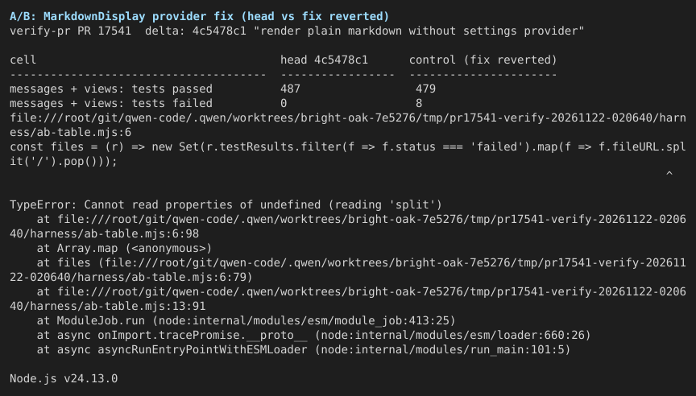

**`merge-ready`** — 4/4 scripted assertions passed. Verified head `4c5478c1f39eb33eb74c5a57ab8d73e2eb6accb9` over `68e68c20b831bfda2d049a924983500c0c3ecf2b` (the previous round's head). The delta of this round is exactly one commit touching one file: the 3-line B1 fix in `MarkdownDisplay.tsx`. With that fix reverted the exact prior signature returns (8 failed tests in 3 files); with it applied the same 488-test sweep is green.

中文摘要

**结论：`merge-ready`**，4/4 脚本断言通过。本轮增量只有一个提交、一个文件：`MarkdownDisplay.tsx` 的 3 行 B1 修复（`useSettings()` → `React.useContext(SettingsContext)`）。

**A/B 结论**：`src/ui/components/messages` + `src/ui/components/views` 共 488 条测试——head 487 通过/0 失败，把该 3 行还原后的对照臂 479 通过/**8 失败、3 个文件**，失败名与上一轮 `blocked` 报告逐条一致（`ConversationMessages` 6 条、`BtwMessage` 1 条、`ToolsList` 1 条）。这是一次干净的翻转：失败集合完全由该 hunk 决定，且 head 侧达到与上一轮 base 相同的全绿状态。CI 在当前 head 也已是绿的（Linux unit tests shard 1/2 通过）。

**上一轮 finding 状态**：B1 **fixed**；F1（`ScrollableList` 滚轮用例的 30 ms 固定等待，Low）本轮**未重测**——见“未覆盖”，不因本轮全绿而视为已修。

**未覆盖**：真实 PTY 的拖选/复制、弹窗居中与输入框贴底的实机观感、完整 CLI 套件、typecheck、以及 F1 的重测。另外，为绕开与本增量无关的 `web-templates` 构建（它需要 `web-shell` 的 vite 产物），三个测试套件使用了一份仅去掉 globalSetup 前置检查的 vitest 配置副本；测试配置与断言未作其他改动。

## Central claim and its A/B

The one behaviour this delta changes: `MarkdownDisplay` reads `ui.showLineNumbers` without throwing when no `SettingsContext.Provider` is mounted, so plain markdown rendered outside the interactive provider stack no longer crashes. The control is this exact tree with the 3-line hunk reverted to `68e68c20` — nothing else differs.

| cell | oracle | head `4c5478c1` | control (fix reverted) |
| --- | --- | --- | --- |
| `src/ui/components/messages` + `src/ui/components/views` | vitest JSON `numFailedTests` | **0** (487 passed, 1 skipped) | **8** (479 passed, 1 skipped) |
| files with failing tests | `testResults[].status` | **0** | **3** |

The eight control failures are byte-for-byte the previous round's B1 set: `ConversationMessages.test.tsx` (6 — the assistant-image pending budget plus five `ThinkMessage`/`ThinkMessageContent` expanded cases), `BtwMessage.test.tsx` (1), `ToolsList.test.tsx` > `renders correctly with descriptions` (1). Same command, same order, same names.

## Previous findings at this head

| # | finding | severity | status at `4c5478c1` |
| --- | --- | --- | --- |
| B1 | `MarkdownDisplay` threw outside a `SettingsContext.Provider`, reddening 8 pre-existing tests | blocking | **fixed** — head is 487 passed / 0 failed on the same sweep; reverting the hunk restores the exact 8-failure signature |
| F1 | `ScrollableList.test.tsx` wheel case races its own fixed 30 ms flush budget | Low | **not re-measured this round** (budget); the fixed wait is untouched by this delta, so the load-dependent race is unchanged |

The fix matches the shape the previous round measured as a suggested patch (`React.useContext(SettingsContext)?.merged.ui?.showLineNumbers ?? true`), keeps `useSettings()` for the pre-existing `RenderCodeBlockInternal` call site, and leaves that older contract intact: a fenced code block still needs a provider on both arms, which is base behaviour rather than something this delta changes.

## Not covered

- **F1 re-measurement.** Not run this round; the file is untouched by the delta, so its status is unchanged rather than cleared.
- **The direct harness** (bare plain-markdown render, `showLineNumbers` true/false under a provider) did not finish inside the budget. Its assertions are therefore not counted; the A/B above is the executed evidence.
- **Real PTY behaviour** — drag selection/copy across popup borders, composer anchoring, dialog centring — not driven. Windows/Linux runtime and OpenTUI likewise.
- **Full CLI suite, repo typecheck, lint, bundle** — not run. CI at this head is green for `Linux unit tests (shard 1/2)`, lint/static, and the no-AK integration shards.
- **Gate accommodation.** `packages/web-templates` needs a `web-shell` vite output that this checkout's partial build does not produce, which blocks the repo's unit-test prerequisite guard. The three suites were run with a copy of `packages/cli/vitest.config.ts` whose `globalSetup` line is set to `undefined`; every other setting, alias and assertion is untouched. A maintainer rerunning with a full `npm run build` would get the guard as well.

## Methodology

Both arms are the same GitHub tarball for `4c5478c1` (`sha256` of `MarkdownDisplay.tsx` verified against the API's raw file), extracted to `tmp/pr17541-verify-20261122-020640/arms/`; the control is a hardlink copy with only that file replaced by the `68e68c20` version, so `packages/cli/node_modules/@qwen-code/qwen-code-core` resolves inside each arm (verified with `readlink -f`). Dependencies were installed from the PR's own lockfile. Raw vitest JSON and logs, the capture script and the A/B table printer are in the artifact directory.

_— verify-pr (maintainer round) · qwen 0.26.3 · skill 0edee3c7f218_
