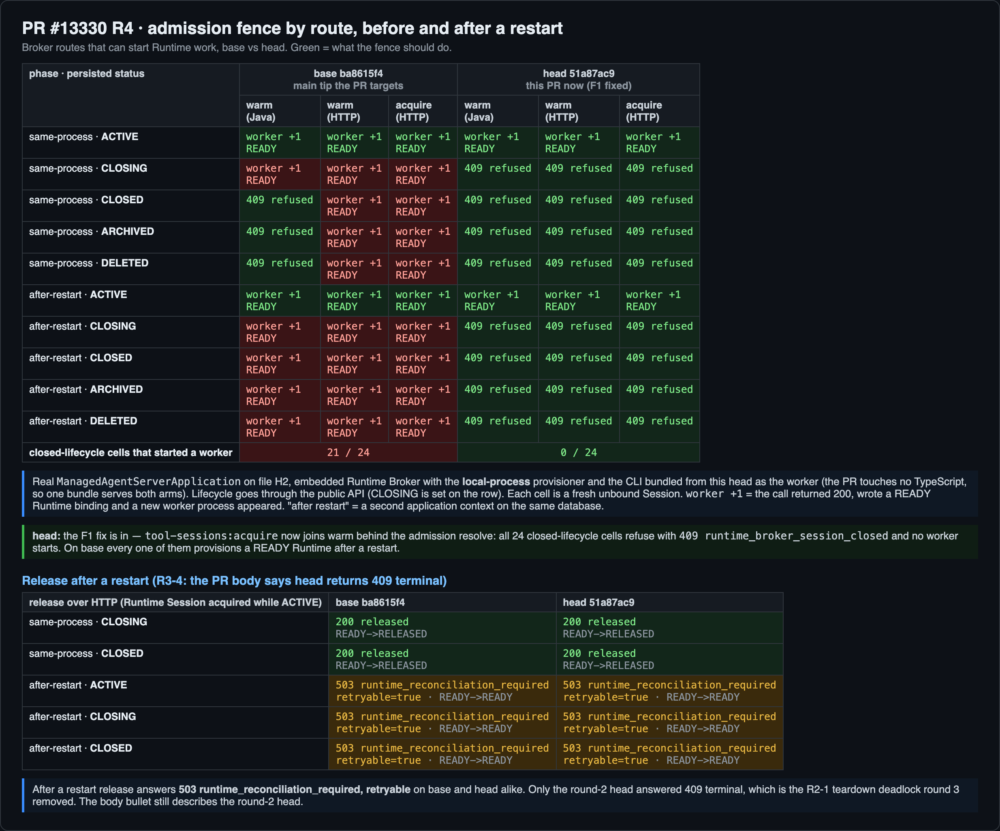
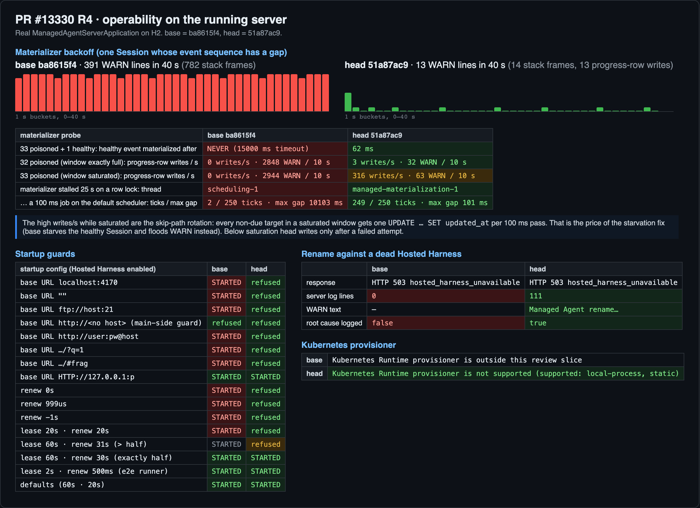
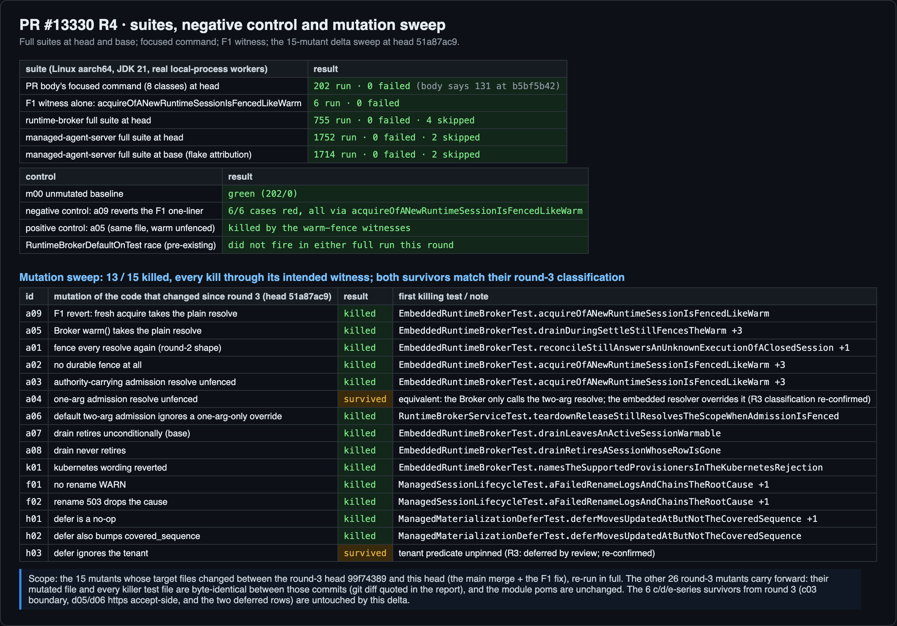

## Maintainer verification, round 4 (delta) — #13330 @ `51a87ac9`

**Verdict: the code is merge-ready — F1 is fixed and everything round 3 measured still holds at this head. The PR body is the one remaining gate: it still describes the round-2/round-3 code and must be edited before merge.** 176 scripted assertions, 176 pass / 0 fail.

Verified head `51a87ac9c2b4469748d64990764155ef22cce3a7`; base `ba8615f4c4c97e9b961f2bd56723b757273f1e5e` (the main tip this PR targets).

中文摘要

**结论：代码可以合入 —— F1 已修复，第 3 轮量过的所有结论在本 head 上仍然成立。剩下的唯一门槛是 PR 描述：它还在描述第 2/3 轮的代码，合入前必须改。** 176 条脚本断言全部通过。

- **F1（第 3 轮的应修缺口）已修复**：`tool-sessions:acquire` 现在和 warm 一样走准入解析。真实栈上，24 个关闭生命周期格子里 0 个拉起 worker（base 是 21/24）；`acquireOfANewRuntimeSessionIsFencedLikeWarm` 见证测试 6/6 通过；把那一行改动回退（变异体 a09）后 6/6 全红。release 语义不变：同进程 200，重启后 503 可重试（R2-1 死结保持修复）。
- **第 3 轮的探针在新 head 上全部重测**（因为 main 的合入改变了输入闭包）：退避（40 秒 WARN 391 → 13）、饿死（永不 → 62 ms）、饱和门控（32 不轮换 / 33 轮换）、独立调度器（默认调度器 249/250 tick，base 只有 2/250）、启动校验（全部非法 URL/租约拒绝，合法放行）、rename WARN、Kubernetes 文案、工具 item 身份，逐项与 base 对比成立。
- **测试**：聚焦 8 类 202/0；runtime-broker 全套 755/0；managed-agent-server 全套 head 1752/0、base 1714/0；本轮两次全量都没碰到已知的 DefaultOn 竞态。
- **变异**：重跑 R3 以来变更文件的 15 个变异体，13 个被杀（每个都死于对应见证测试）；a04、h03 两个存活体与第 3 轮的分类一致（等价变异体 / 已延后的未钉住边界）。
- **PR 描述仍未改**（F2 维持）：release 的 "409 terminal" bullet、"Tests run: 131"、旧的 rename 文案、租约规则、"Breaking changes: None"、Evidence 旧数字、CI 状态段，逐行重核仍然过时（明细见正文表格）。

平台：Linux aarch64 云主机（8C/15G），JDK 21.0.12 + Maven 3.9.9 + Node 24，真实 `ManagedAgentServerApplication`（H2 文件库）+ 从本 head 打包的真实 CLI worker。CI 在本 head 全绿（含 Hosted MySQL 8.4 与 MariaDB 车道）。

### Previous-finding status (round 3 → this head)

| # | Finding (round 3) | Severity | Status at `51a87ac9` |
|---|---|---|---|
| F1 | `tool-sessions:acquire` outside the admission fence | should-fix | **fixed** — code + witness measured below |
| F2 | PR body stale (release-409 bullet, test count, rename WARN text, lease rule, breaking-changes claim, evidence table, CI status) | must edit before merge | **stands** — body unedited (re-checked row by row below) |
| d05/d06 | boot guard's accepting side unpinned (https, upper-case scheme) | suggestion | stands — delta did not touch it |
| c03, h03 | unpinned half-lease boundary / defer tenant predicate | deferred by review | stands — re-confirmed by mutants below |

### What changed since round 3 (`99f74389` → `51a87ac9`)

- A merge of current `main` (`ba8615f4`): +8006/−41 inside `packages/sdk-java` alone (child workspaces, team records, session message records), plus main's TypeScript-side changes. The PR's own diff stays Java-only (`git diff ba8615f4..51a87ac9`: 25 files, all under `packages/sdk-java` plus the two design notes and the README).
- `51a87ac9` — the F1 fix, byte-identical to the candidate patch round 3 verified: `RuntimeBrokerService.acquire()`'s fresh-acquire path now calls `resolveScope(harnessId, true, authority)`, plus the six-status witness `acquireOfANewRuntimeSessionIsFencedLikeWarm`.

Because the merge changed the input closure of every round-3 measurement, **all probes were re-run at this head against the new base**, nothing quoted from round 3.

### F1 — fixed, on the real stack

Real `ManagedAgentServerApplication` on file-backed H2, embedded Runtime Broker with the local-process provisioner, the CLI bundled from this head as the worker (the PR touches no TypeScript — the two arms' `packages/cli`, `packages/core`, manifests and lockfile are byte-identical, so one bundle serves both):

- **head: 0 / 24** closed-lifecycle cells start a worker. Every route (`EmbeddedRuntimeBroker.warm`, `POST …/runtimes:warm`, `POST …/tool-sessions:acquire`) refuses CLOSING/CLOSED/ARCHIVED/DELETED unbound Sessions with `409 runtime_broker_session_closed`, in-process and after a restart, no binding written, no worker spawned.
- **base: 21 / 24** start a worker — including all 12 after-restart cells (the durable bug this PR exists to fix) and every acquire cell (F1's shape on the round-3 head).
- **Release is unchanged on both arms** (lower table): 200 in-process, `503 runtime_reconciliation_required` retryable after a restart — so the fix did not re-create the R2-1 teardown deadlock, and the PR body's "Release after a restart → 409 terminal" bullet remains wrong (see below).

Suite pins: `acquireOfANewRuntimeSessionIsFencedLikeWarm` 6/6 green at head; reverting the F1 line (mutant `a09`) turns exactly those 6 cases red and nothing else; the positive control `a05` (warm unfenced, same file) is killed by the warm-fence witnesses. Raw probe output: `r4-03-ab-probe-raw.png`.

### Round-3 claims re-measured at this head

- **Materializer backoff:** one always-failing Session logs **13 WARN lines in 40 s** at head (base: **391**), with 13 progress-row writes; the exponential cadence is visible in the per-second bars.
- **Starvation:** a healthy Session behind 33 poisoned ones materializes in **62 ms** at head; on base it never materialized (15 s limit).
- **Saturation gate:** exactly-full window (32) → 3 writes/s, all after failed attempts; saturated (33) → 316 writes/s rotation. Base floods ~290 WARN/10 s in both.
- **Own scheduler:** with a row lock held 25 s, head blocks `managed-materialization-1` and a 100 ms job on the default scheduler still runs **249/250** ticks (max gap 101 ms); base blocks `scheduling-1` and the job runs **2/250** (max gap 10.1 s).
- **Startup guards:** all six bad base-URL shapes and all five bad lease settings refused at head, all accepted by base; the valid shapes (upper-case `HTTP://`, renew exactly half the lease, the e2e runner's 2 s/500 ms, defaults) still start. `base_url_no_host` is refused on both arms by a main-side plaintext-http guard (not this PR).
- **Rename against a dead Harness:** 503 + WARN `Managed Agent rename failed …` with the `ConnectException` cause at head; 503 with zero log lines on base.
- **Kubernetes:** `not supported (supported: local-process, static)`; base still says "outside this review slice".
- **Tool item identity:** all three event orderings yield one item on both arms, and a `tool_call` stored by the base build still merges with its update under the head build (`same_item=true` across the upgrade).

### Suites and mutation

- Focused PR-body command (8 classes) at head: **202 run, 0 failed** — the body's "131 at `b5bf5b42`" is two heads stale.
- Full surefire at head: runtime-broker **755/0**, managed-agent-server **1752/0**. At base: managed-agent-server **1714/0**. Neither full run hit the pre-existing `RuntimeBrokerDefaultOnTest` race this round.
- **Mutation sweep over the code that changed since round 3** (15 mutants: the a-series fence, the F1 revert, rename, defer SQL, k8s wording): **13 killed, every kill through its intended witness**. Two survivors — `a04` (equivalent: the Broker only calls the two-arg resolve) and `h03` (defer tenant predicate unpinned) — exactly the classifications round 3 recorded.
- The other 26 round-3 mutants **carry forward**: their mutated files and every killer test file are byte-identical between `99f74389` and `51a87ac9` (verified with `git diff`; the only changed test file is `EmbeddedRuntimeBrokerTest`, whose mutants are all in the re-run set), and the module poms are unchanged.

### The PR body at `51a87ac9` — still the merge gate (F2 stands)

Each row re-checked against this head:

| Body says | This head does | Evidence |
|---|---|---|
| Risk: "Release after a restart … now fails with `409 runtime_broker_session_closed` (terminal)" | `503 runtime_reconciliation_required`, retryable — identical to base. Only the round-2 head answered 409 | Fig. 1 lower table |
| Test plan: "At `b5bf5b42` this reports `Tests run: 131`" | **202** at this head | Fig. 3 |
| Rename: logs "Hosted Harness rename failed" | `Managed Agent rename failed tenant=… session=…` | Fig. 2 |
| Lease: "renew interval must also be shorter than the lease" | At least 1 ms **and at most half** the lease | startup probe |
| "Breaking changes: None" | A renew interval above half the lease (31 s / 60 s) starts on main and is now refused | startup probe |
| Evidence table "After is this PR at `b5bf5b42`", "main differs from `43a6e1e5` by one comment line" | Both columns re-measurable from this round: WARN 391 → 13, starvation never → 62 ms | Fig. 2 |
| CI: "Both [lanes] were cancelled … tracked in #13542" | All checks green at `51a87ac9`, including Hosted MySQL 8.4 (40m55s) and MariaDB (13m59s); #13542 closed Oct 7 | `gh pr checks` |
| First bullet: "the Runtime Broker refuses an unbound Session whenever its persisted status is …" | **Now true on every admission route** — acquire included (F1) | Fig. 1 |

The first row was the other way around in round 3 (the body overclaimed; now the code matches it). The rest still describe older heads.

### Not covered

- The MySQL 8.4 / MariaDB Hosted lanes were not re-run locally; both are green in CI at this head.
- Everything ran on Linux aarch64; CI covers x86, macOS and Windows for qwencode and runtime-broker, and the Hosted lanes cover managed-agent-server on x86 Linux.
- The 26 carried-forward round-3 mutants were not re-executed (input closure shown unchanged, per the report section above).
- `d05/d06` (nothing tests the boot guard's https-accepting side) and `c03`/`h03` remain open by review deferral; this delta does not touch them.
- The verify host shares the box with an unrelated rig; the two timing probes (stall, backoff) were re-checked against their base-arm controls and both matched the round-3 shape.

### Methodology

Cloud Linux aarch64 (8 C / 15 GB), JDK 21.0.12, Maven 3.9.9, Node 24. Two shallow worktrees (`base` `ba8615f4`, `head` `51a87ac9`); per-arm Maven repositories over a decontaminated shared download cache — the arms' runtime-broker jars differ and their qwencode jars are CRC-identical, confirming no cross-arm leak. The CLI worker is the bundle built from the head tree (TS trees byte-identical across arms). Probes are the round-3 harness (`Pr13330R3*Probe`), driving the real server over H2 with local-process workers; the startup/fence/operability/identity logs are replayed into a scripted assertion engine (176 assertions, PASS/FAIL per line, `assertions.json`). Mutations are applied as single-hunk text edits on a copy of the head tree and run against the eight focused classes; `m00` (unmutated) is the green baseline. Full raw logs: artifact bundle `tmp/pr13330-verify-20261011-091034/` locally, plus the evidence link below.

Evidence (figures, probe logs, mutation logs, collectors): [`asserts` branch, `pr-13330/r4/`](https://github.com/wenshao/qwen-code/tree/asserts/pr-13330/r4)

cc @wenshao — the body rows above are the edit list; everything else is ready.
