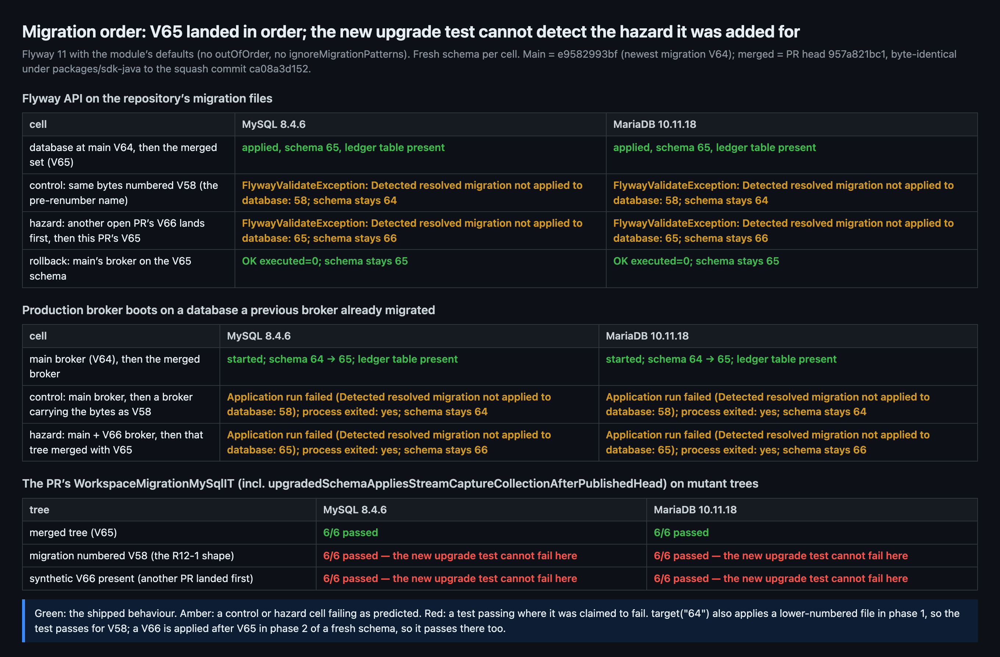
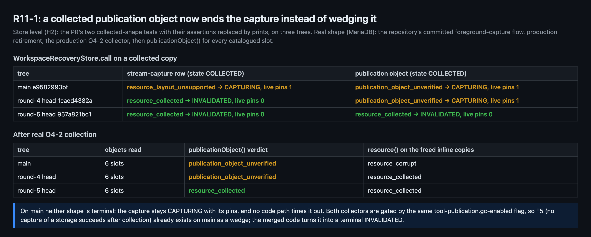
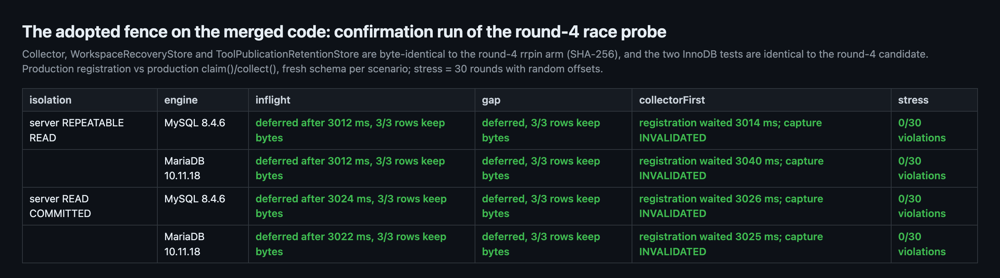
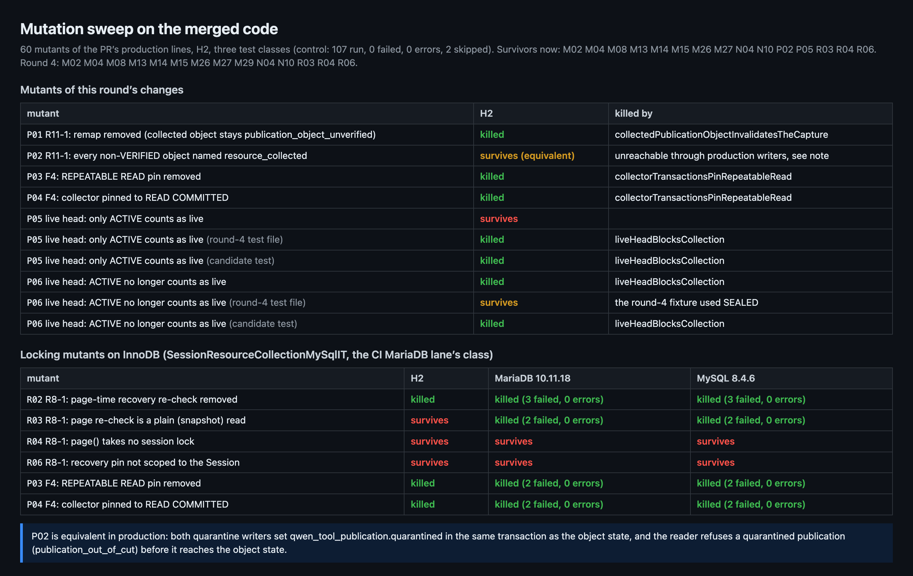
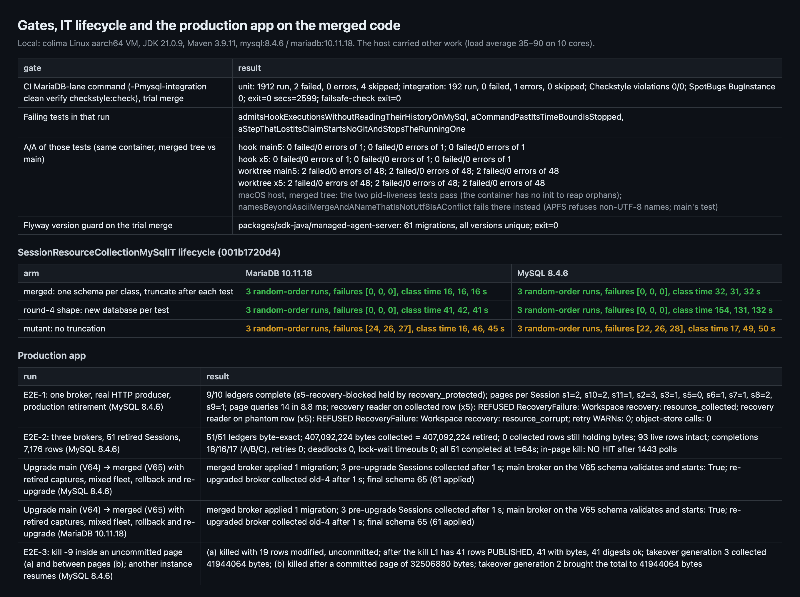

## Maintainer verification, round 5 (post-merge): #13554 at `957a821bc1`, squash `ca08a3d152`

**Verdict: findings, post-merge. I found no defect in the merged code.** The PR was merged at 03:11Z while this round was running. The squash commit `ca08a3d152` is byte-identical under `packages/sdk-java` to the tree measured here: head `957a821bc1` merged with main `e9582993bf`, a 0-line diff.

What the merged code does, measured on MySQL 8.4.6 and MariaDB 10.11.18:
- **V65 landed in order.** Main's newest migration was V64. A broker built from main migrates a database to V64; the merged broker then applies exactly one migration (V65) and collects the pre-existing retired captures. A broker built from main still starts on the V65 schema.
- **R11-1 is fixed.** On main and at the round-4 head, a collected publication object leaves the capture in `CAPTURING` with its pins held. At this head it ends `INVALIDATED` with `resource_collected`, and the pins are released.
- **The fence holds.** The round-4 fence candidates were adopted verbatim and hold on InnoDB: 0/30 race violations on both engines, under REPEATABLE READ and under READ COMMITTED.

Follow-ups, none urgent:
- **F7 (process):** no gate checks migration order, and the test added for R12-1 cannot fail. Both CI Flyway checks test only that versions are unique.
  - The hazard was live for 49 minutes: #13530 landed V66 at 04:01Z. Had it landed first, nothing in CI would have caught it, because every database-backed IT migrates a fresh schema in ascending order. A broker on any database migrated to V66 in between would then have refused to start: `Detected resolved migration not applied to database: 65` (measured on both engines).
  - The new `upgradedSchemaAppliesStreamCaptureCollectionAfterPublishedHead` passes with the file numbered V58 and with a V66 present.
  - Suggestion: an ordering rule in `scripts/check-flyway-open-prs.js`.
- **F5 (product, unchanged):** this is still open before anyone enables `gc-enabled`, but it is not new. The same flag gates the publication collector already on main. There, a capture that meets collected bytes stays `CAPTURING` forever; the merged code ends it as `INVALIDATED`. Either way, the capture cannot succeed.
- **F8 (low):** switching `liveHeadBlocksCollection` from SEALED to ACTIVE changed which narrowing of the blocker the test catches, not how many. A two-value parameterized version catches both (measured).
- **PR description:** it still says V48, `Tests run: 1083` and 44 collector tests. The squash message is the commit list, so the stale text did not reach git history; only the PR page is stale.

Results ledger: 14 Flyway cells, 6 broker boots, 16 race results, 60 mutants plus 8 extra mutation arms, and 52 targeted test runs. Every number below comes from `results.json` in the [evidence folder](./).

中文摘要（点击展开）

**结论：有发现（findings），合入后验证；合入的代码没有发现缺陷。** 本 PR 在本轮验证进行中（03:11Z）已合入，squash 提交 `ca08a3d152`。它在 `packages/sdk-java` 下与本轮实测的树完全相同：head `957a821bc1` 与 main `e9582993bf` 的试合并，0 行差异。

**实测结论（MySQL 8.4.6 与 MariaDB 10.11.18）：**
- **V65 按顺序落地。** 当时 main 最新的迁移是 V64。先用 main 的 broker 把库迁到 V64，再启动合入后的 broker：只应用了 V65 这 1 个迁移，并回收了升级前已退休的会话。main 的 broker 在 V65 的库上照样能启动。
- **R11-1 已修复。** 在 main 和第 4 轮的 head 上，已回收的 publication object 会让 capture 卡在 `CAPTURING`，并一直占着 pin。本轮 head 上它以 `resource_collected` 结束为 `INVALIDATED`，pin 随之释放。
- **栅栏成立。** 第 4 轮的 F3/F4 候选补丁被原样采纳，在 InnoDB 上依然成立：两种库、REPEATABLE READ 与 READ COMMITTED 两种隔离级别下，竞态压力测试均为 0/30 违规；回收先行时，登记在 READ COMMITTED 下也要等约 3 秒。

**后续跟进（都不紧急）：**
- **F7（流程）：** 没有任何门禁检查迁移顺序，而为 R12-1 新加的测试本身不可能失败。CI 的两个 Flyway 检查都只查版本号唯一。
  - 这次险情真实存在：#13530 在 04:01Z 合入了 V66，只比本 PR 晚 49 分钟。如果它先合入，CI 什么也拦不住，因为所有连数据库的 IT 都是在空库上按升序迁移的。而在这 49 分钟里已迁到 V66 的数据库，会拒绝启动合入本 PR 后的 broker（`Detected resolved migration not applied to database: 65`，两种库实测）。
  - 新测试 `upgradedSchemaAppliesStreamCaptureCollectionAfterPublishedHead` 在迁移编号为 V58 时、以及存在 V66 时都通过。
  - 建议：在 `scripts/check-flyway-open-prs.js` 加一条顺序规则，PR 新增的版本号必须高于 main 当前的最大版本。
- **F5（产品决定，仍未定）：** 开启 `gc-enabled` 前仍需决定，但这不是本 PR 引入的。同一个开关已经控制着 main 上的 publication 回收器：main 上遇到已回收字节的 capture 会永久停在 `CAPTURING`，合入后的代码把它改成了终态 `INVALIDATED`。无论哪种，该存储都无法再成功 capture。
- **F8（低）：** `liveHeadBlocksCollection` 从 SEALED 改成 ACTIVE 后，只是换了一种能抓住的判定收窄，并没有多抓。改成 ACTIVE、SEALED 两值参数化后两种都能抓住（已实测，候选 diff 附后）。
- **PR 描述：** 仍写着 V48、`Tests run: 1083` 和 44 个回收器测试。squash 提交说明用的是提交列表，过期内容没有进入 git 历史，只是 PR 页面上的描述过期。

**自我更正：** 第 4 轮验证 V57 改号时只测了版本唯一（Flyway 脚本加空库 IT），没有测"从已在 main 最新版本的库升级"，所以发现不了乱序。V58 后来就是从这个缺口漏过去的（R12-1）。本轮补上了这一格。

**其他实测：**
- **变异测试：** InnoDB 车道上，R03（页内重查改为普通读）现在被测试杀死，说明 F3 在 CI 里已有测试钉住；P01、P03、P04 也都被杀。R04、R06 仍存活，属已延后项。P02 是等价变异。
- **IT 生命周期：** 改为每类一个 schema 后，在 3 种随机方法顺序下都是 61/61 通过，耗时约为原来的 1/2.6（MariaDB）到 1/4.5（MySQL）。去掉截断会出现 22–28 个失败，说明截断有测试作见证。
- **G1 门禁：** 单元 1912 个，IT 192 个，Checkstyle 0 违规，SpotBugs 0。3 个红项在 main 上做了 A/A：2 个 `ChildWorktreeGitTest` 在 main 上同样失败（容器里没有 init 回收孤儿进程）；1 个 hook IT 单独跑时在两边都通过（负载抖动）。
- **生产应用 E2E：** E2E-1、E2E-2（51/51 会话逐字节一致，共 407,092,224 字节，0 次死锁）、E2E-3（页内被杀、页间被杀两种情况都能由其他实例接手续收，结果逐字节一致）、两种库上的升级 / 回滚 / 再升级，全部通过。

**未覆盖：**
- TS worker 驱动的端到端 capture：worker 会读取每个源会话的全部 manifest 页和对象，这一点仍只来自读代码。
- Hosted/OSS 部署。
- Java 11/17 矩阵（CI 已覆盖）。

### Correction to round 4

Round 4 measured the V57 rename only against version uniqueness: the Flyway script and a fresh-schema IT. It did not test an upgrade from a database already at main's newest migration, so it could not have caught an out-of-order number. That gap is how V58 later passed every uniqueness gate while sitting below main's V60 and V62 (R12-1). This round adds that cell, through Flyway's API and through real broker boots.

### Previous findings

| Round-4 item | Status at `957a821bc1` | Evidence this round |
| --- | --- | --- |
| **B1** V56 collided with #13545 | Resolved. Renumbered V57 → V58 → V65; the content is byte-identical. The successor R12-1 (V58 sat below main's V60/V62) is resolved by V65. | Flyway script on the trial merge: 61 migrations, all unique. Upgrade from main V64 applies V65 on both engines; the V58 control fails validation (§1). |
| **F3** nothing pinned the page's `FOR UPDATE` (R03) | Adopted verbatim: `uncommittedRecoveryRegistrationHoldsThePageUntilItCommits` and `SessionResourceCollectionMySqlIT`. | R03 survives on H2 by design. On both engines it is killed by that test and by `pageGapLockHoldsARegistrationEvenOnAReadCommittedPool`. The CI MariaDB lane runs this IT. |
| **F4** READ COMMITTED loses the gap lock | Adopted verbatim: the 3-line REPEATABLE READ pin and `pageGapLockHoldsARegistrationEvenOnAReadCommittedPool`. Also added: an H2 witness, `collectorTransactionsPinRepeatableRead`. | P03 (pin removed) and P04 (pinned to READ COMMITTED) are killed on H2 and on both engines. With the server at READ COMMITTED: 0/30 violations, and a collector-first registration waited 3,026 / 3,025 ms (round 4 without the pin: 19 / 10 ms). |
| **F5** collection invalidates later captures and migrations | Open. AutoFix escalated it as a product decision; the docs are unchanged apart from renumbering. | Reframed in §4: pre-existing on main under the same flag. |
| **F6** survivors R04, R06, M29 | Deferred, unchanged. | R04 and R06 survive on H2 and on both engines. M29 was killed this sweep, consistent with its 4/10 witness (round-4 correction). |
| PR description stale | Still stale | Not in the squash message |
| `reviewDecision` | Approved by qqqys, yiliang114 and the review bot; merged 03:11Z | — |

### What changed since round 4

- **Production code, 2 hunks.**
  - The REPEATABLE READ pin: my F4 candidate, verbatim.
  - The R11-1 remap in `WorkspaceRecoveryReader.publicationObject`: one expression.
  - The migration bytes are identical to round 4's V56; only the name moved, to V65.
- **Tests.**
  - The F3/F4 tests are identical to the round-4 candidate.
  - New: `collectorTransactionsPinRepeatableRead`, `collectedPublicationObjectInvalidatesTheCapture` and `upgradedSchemaAppliesStreamCaptureCollectionAfterPublishedHead`.
  - Changed: the `liveHeadBlocksCollection` fixture, SEALED → ACTIVE.
  - Changed: `SessionResourceCollectionMySqlIT` now uses one schema per class and truncates after each test.
- **Merges.** `git show --remerge-diff` over the six merge commits shows only two kinds of change: the `WorkspaceMigrationMySqlIT` version-list conflict resolutions, and the V57 → V58 renumber folded into `76f26332fd`. No production Java changed in a merge.
- **Closure for carried-forward results.**
  - `SessionResourceCollectionCollector`, `WorkspaceRecoveryStore` and `ToolPublicationRetentionStore` are byte-identical (SHA-256) to round 4's measured `rrpin` arm.
  - `WorkspaceMigrationStore` differs only by main's own changes; the PR's hunk there is unchanged.

### 1. Migration order (F7)

- **Real brokers** (table 2).
  - A broker from main brings the database to V64, and the merged broker starts and applies V65.
  - The same bytes numbered V58 fail: `Application run failed … Detected resolved migration not applied to database: 58`. The process exits and the schema stays at 64. That is R12-1 reproduced on a real broker.
  - Main plus a synthetic V66, followed by that tree merged with V65, fails the same way at 65. This is the order #13530 and this PR could have landed in.
- **The new test is vacuous** (table 3). `upgradedSchemaAppliesStreamCaptureCollectionAfterPublishedHead` runs `target("64")` and then migrates with no target.
  - `target("64")` also applies any lower-numbered file, so with the migration as V58, phase 1 applies it and the test passes. This was measured: `WorkspaceMigrationMySqlIT` passed 6/6 on both engines.
  - With a V66 present, a fresh schema applies V65 and then V66 in phase 2, so the test passes again.
  - The reply on R12-1 says the test is "red against V58's IGNORED validation". Measured, it is green.
  - It is harmless on main, but it protects nothing.
- **Why a test cannot be the gate.** Any in-repo test that assumes "this migration is the newest" turns red on main as soon as the next migration lands. The invariant is relative to main at the moment of landing.
- **Suggested gate.** In `scripts/check-flyway-open-prs.js` `evaluate()`, fail a PR when a version it adds is not above main's newest version. That job already re-runs on every main push that touches a migration, so it would have turned this PR red on the first push after V60. It would also turn a PR red when another PR lands a higher number first. A matching check in `check-flyway-migrations.js` could compare the merge ref's added files against `HEAD^1`.

### 2. R11-1: collected publication objects

- **Store level** (H2, the PR's two collected-shape tests with their assertions replaced by prints):

  | Tree | Stream-capture row | Publication object |
  | --- | --- | --- |
  | main | `resource_layout_unsupported`: `CAPTURING`, 1 pin | `publication_object_unverified`: `CAPTURING`, 1 pin |
  | round-4 head | `INVALIDATED`, 0 pins | `CAPTURING`, 1 pin (R11-1) |
  | merged | `INVALIDATED`, 0 pins | `INVALIDATED`, 0 pins |

  No code path times a `CAPTURING` operation out: the worker invalidates only on `source_drift` or an unsupported entry.
- **Real shape** (MariaDB): the repository's committed foreground-capture flow, then production retirement and the production O4-2 collector.
  - The collector leaves `producer_phase=REFERENCED`, `quarantined=false` and the object `COLLECTED`. Those are the fields the reader checks before the remap, so the PR's hand-built row matches.
  - All 6 collected slots, including the object-store segments, answer `resource_collected` at the merged head and `publication_object_unverified` on main and at the round-4 head.

### 3. The adopted fence on the merged code

This is the round-4 `RecoveryRaceProbe`: the production registration against the production `claim()`/`collect()`, on a fresh schema per scenario.

| Scenario | REPEATABLE READ | READ COMMITTED |
| --- | --- | --- |
| Registration uncommitted during the page | Page deferred after ~3.0 s | Page deferred after ~3.0 s |
| Registration committed between claim and page | Page deferred | Page deferred |
| Collector first | Registration waited 3,014–3,040 ms, then the capture is `INVALIDATED` | Same |
| 30 stress rounds | 0 violations | 0 violations |

Under READ COMMITTED, round 4's unpinned head let that registration through in 19 / 10 ms, with 1/30 violations on MariaDB. With the pin it now waits as it does under REPEATABLE READ. Both servers' global isolation was restored to REPEATABLE READ afterwards.

### 4. F5 is older than this PR

- **One flag, two collectors.** `tool-publication.gc-enabled` gates both `ToolPublicationCollector` (O4-2, on main) and the new `SessionResourceCollectionCollector`.
- **Main today.** With the flag on, a capture or migration of a storage whose retired Session had a publication collected meets `resource_corrupt` (freed inline copy) or `publication_object_unverified` (object). Both leave it `CAPTURING` indefinitely (§2).
- **Merged code.** It turns that into a terminal `INVALIDATED` and adds stream-capture rows to the bytes that can be collected.
- **What has not changed.** After collection, no capture of that storage can succeed.
- **Recommendation, unchanged.** Add one sentence to the operations doc's enablement gates: enabling `gc-enabled` ends workspace capture and W1c migration for any storage with collected retired Sessions. Then decide on the skip-collected-Sessions design separately.
- **A related pre-existing wedge, outside this PR.** A quarantined publication is refused with `publication_out_of_cut`, which is not terminal either. It was measured at the reader on the same fixture, before its quarantine was reset.

### 5. Mutation

- **Scope.** 60 mutants of the PR's production lines on H2, three test classes. The control is 107 run, 0 failed, 2 skipped (the two InnoDB-only tests).
- **This round's changes.**
  - P01 (remap removed): killed by `collectedPublicationObjectInvalidatesTheCapture`.
  - P03 and P04 (pin removed or set to READ COMMITTED): killed by `collectorTransactionsPinRepeatableRead`.
  - P02 (every non-VERIFIED object named `resource_collected`) survives, but it is equivalent in production. Both quarantine writers set `qwen_tool_publication.quarantined` in the same transaction as the object state, and the reader refuses a quarantined publication before it reaches the object state.
- **F8.**
  - With the round-4 test file, P05 ("only ACTIVE is live") is killed and P06 ("ACTIVE is not live") survives. With the merged file it is the reverse.
  - [Candidate](./candidate/live-head-both-states.diff): `liveHeadBlocksCollection` parameterized over `ACTIVE` and `SEALED`. It kills P05, P06 and R10; the control is 108/108 and Checkstyle is clean.
- **InnoDB lane** (`SessionResourceCollectionMySqlIT`, which the CI MariaDB lane runs).
  - Killed on both engines: R02 (page re-check removed), R03 (plain re-check), P03 and P04. F3 is therefore pinned in CI now.
  - R04 (page without the session lock) and R06 (unscoped pin) still survive on both engines, as in round 4. They remain deferred.
- **Unchanged H2 survivors.** M02, M04, M08, M13–M15, M26, M27, N04 and N10 are the same as round 4, and were classified there.

### 6. Gates, IT lifecycle and the production app

- **The CI MariaDB lane's command on the trial merge.**
  - Unit tests: 1912, with 2 failures. Integration tests: 192, with 1 error.
  - Checkstyle: 0 violations. SpotBugs: 0. The failsafe report check passes, and the PR's own ITs pass (61 + 6 + 3).
  - All three reds are main's tests outside the PR's files:
    - The 2 `ChildWorktreeGitTest` pid-liveness failures reproduce 3/3 on main in the same container. They pass on the macOS host, which points to the container having no init to reap orphans.
    - `admitsHookExecutionsWithoutReadingTheirHistoryOnMySql` hit its 60 s writer lease under load. It passes 3/3 alone, on both main and the merged tree.
- **`SessionResourceCollectionMySqlIT` with one schema per class** (`001b1720d4`).
  - 61/61 in three random method orders on both engines.
  - Class time drops from 41 → 16 s on MariaDB and from 131–154 → 31–32 s on MySQL.
  - Without the truncation, 22–28 tests fail per run, so the isolation step is load-bearing and witnessed.
  - On CI, this class took 22 s of the MariaDB lane's 14m22s. That lane runs 11–14 minutes on main pushes alone, so its 15-minute ceiling is main's margin to watch, not this PR's.
- **Production app on the merged classes.**
  - E2E-1: page boundaries and the 5,120-byte phantom match round 4.
  - E2E-2: three brokers, 51/51 Sessions byte-exact, 407,092,224 bytes, completions 18/16/17, 0 deadlocks.
  - E2E-3:
    - A kill inside an uncommitted page rolls back all 41 rows, digests intact, and a takeover collects 41,944,064 bytes.
    - A kill between pages resumes from the committed 32,506,880 bytes to the same total.
  - Upgrade, mixed fleet, rollback and re-upgrade: pass on both engines.

### Not covered

- The TypeScript capture worker driving a real capture end to end. That the worker reads every manifest page and object of each source Session is still taken from reading the code.
- Hosted/OSS deployment.
- The Java 11/17 matrix (CI covered it).
- Binlog volume and the monotonic-clock cadence: the code is unchanged and they were measured in rounds 3–4.
- E2E-2's in-page kill timing did not land this run (`NO HIT`, as in round 4). E2E-3 covers both kill points.

### Methodology

- **Rig.** A colima Linux aarch64 VM (6 CPUs, 16 GB) with JDK 21.0.9 and Maven 3.9.11 offline, running mysql:8.4.6 and mariadb:10.11.18 on an internal Docker network with no published ports. The macOS host ran the H2 mutation sweep.
- **Arms.**
  - The merged tree: a trial merge of `957a821bc1` with `e9582993bf`.
  - Main at `e9582993bf`.
  - The round-4 head at `1caed4382a`.
  - Mutants: each is one textual edit of a clone. Every clone is detached from git, and stale compiled resources were removed where a file moved.
- **Probes.** All are verification-only test classes, not part of the PR.
  - `MigrationOrderProbe`: Flyway API.
  - `PublicationObjectProbe`: the real O4-2 flow.
  - Round 4's `RecoveryRaceProbe`.
  - `order5.sh`: production broker boots.
- **Evidence.** The figures and every number in this comment are generated from `results.json` by `ledger.py`. Probes, scripts, raw logs and the candidate diff are in the [evidence folder](./).
