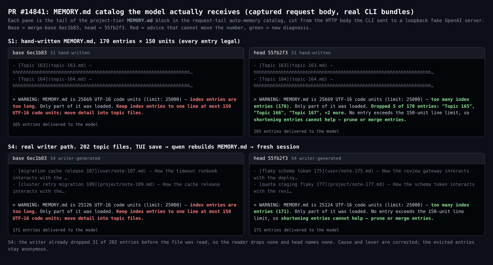
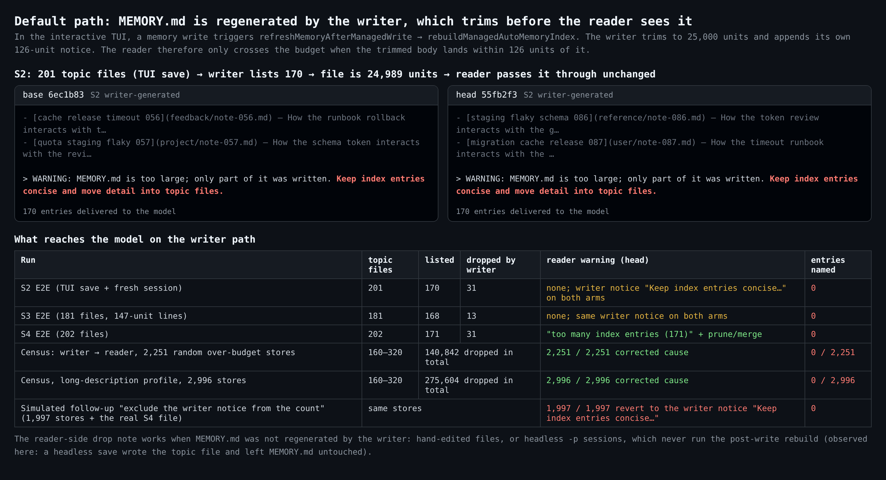
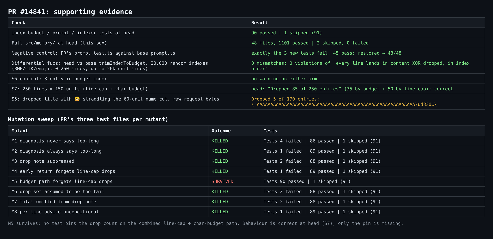

## 维护者验证：在 `55fb2f3` 上做真实栈 A/B

**结论：可以按现状合入。** 新的诊断是正确的，也作用到了默认路径上；没有发现阻塞问题。writer 侧需要单独看：在那条路径上，本 PR 新增的丢弃说明从不触发；而本线程里计划的后续修复，会把本 PR 在那条路径上的效果抵消掉。详见下文"关于后续修复的规划"。

**环境。** 我在 Linux x64 上构建了两份真实的 CLI bundle：merge-base `6ec1b83` 和本 head `55fb2f3`。merge-base 之后 main 没有改动过 `packages/core/src/memory/`，所以对这部分代码而言，本 head 就等同于合入结果。每次运行都用全新的 `HOME` 和 git 项目，连接一个本地回环的假 OpenAI 服务器。我直接从 CLI 发出的 **HTTP 请求体**里截取项目层 `MEMORY.md` 区块，所以下文引用的就是模型实际收到的文本。全程没有用真实模型。

作者此前的 TUI 验证已经在 macOS 上覆盖了手写 fixture 和对照组。我在 Linux 上重跑了这些，主要时间花在那轮没有走到的路径上：由 qwen 自己根据 topic 文件重新生成的 `MEMORY.md`。

### 1. 手写索引：按描述修复

| 场景（手写 `MEMORY.md`） | base `6ec1b83` | head `55fb2f3` |
| --- | --- | --- |
| 170 条 × 150 码元，全部合法（25,669） | `index entries are too long` + `Keep index entries to one line at most 150…` | `too many index entries (170)` · `Dropped 5 of 170 entries: "Topic 165", "Topic 166", "Topic 167", +2 more` · `prune or merge entries` |
| 250 行 × 150 码元（同时超行数上限和字符预算） | 单行长度建议 | `Dropped 85 of 250 entries`（35 条因字符预算 + 50 条因行数上限）✔ |
| 3 条、预算内的对照组 | 无告警 | 无告警 |

### 2. 默认路径：writer 先裁剪，reader 一条也点不出名

在交互式 TUI 里，写入一条记忆会调用 `refreshMemoryAfterManagedWrite`，进而调用 `rebuildManagedAutoMemoryIndex`。writer 用的是同一个 `trimIndexToBudget`，裁剪后再追加它自己那条 126 码元的 `INDEX_TRUNCATION_NOTICE`。等 reader 读到文件时，正文已经 ≤ 25,000 码元。我把这条路径真实地跑了一遍：先预置 topic 文件，在 TUI 里让它再记住一条事实（假模型返回一个写入记忆目录的 `write_file`），然后新开一个会话并抓取它的请求。

| 运行 | topic 文件 | 列出 | 被 writer 丢弃 | head 上模型收到的内容 | 点名条数 |
| --- | --- | --- | --- | --- | --- |
| 202 个文件 | 202 | 171 | 31 | `25124 UTF-16 code units … too many index entries (171) … prune or merge entries` ✔ | **0** |
| 201 个文件 | 201 | 170 | 31 | reader 不告警；文件为 24,989 码元，所以 writer 自己的 `Keep index entries concise and move detail into topic files.` 被原样透传，**两臂完全相同** | **0** |
| 181 个文件，每行 147 码元 | 181 | 168 | 13 | 同上一行，两臂完全相同 | **0** |

之后我又用构建出的 head dist 里真实的 writer → reader 函数处理合成 store。在 5,247 个随机生成的超预算 store 上，reader 的告警**全部**给出了修正后的原因和建议，但**没有一条**点出条目名，尽管 writer 在这些 store 里一共丢弃了 416,446 条。201 和 181 个文件那两行只在 writer 生成的行长度几乎一致时出现；随机普查里没有碰到，但它们是可达的。

所以，原因与建议的修正落到了默认路径上；丢弃说明只对没有被 writer 重新生成的 `MEMORY.md` 生效。这类文件有两种来源：手工编辑的文件，以及 headless `-p` 会话。headless 会话从不执行写入后重建，因为重建只接在 `use-llm-stream.ts` 和 ACP 的 `Session.ts` 里。在本次环境中，一次 headless 保存写入了 topic 文件，`MEMORY.md` 没有被动过。另外一个细节：writer 按 mtime 从新到旧排序，所以它丢掉的是**最旧**的记忆，而且不留任何提示。

#14834 里报告的 25,020 码元正好落在这个区间：最多 25,000 的正文加上 126 码元的 notice。对那份报告而言，本 PR 修正了措辞，但没有点出任何条目。

### 关于后续修复的规划

本线程前面把"~126 码元 notice 边界"当作什么都没丢的状态，并提出了两种修法：用 `dropped.length > 0` 守住建议，或者计数时排除 notice。但在 writer 路径上，条目**确实丢了**，是 writer 在 reader 运行之前丢的。而且这个区间并不是边界情况，所有 writer 生成的超预算索引都会落进去。

我在 head 的 reader 上模拟了"计数时排除 notice"。在 1,997 个 writer 生成的超预算 store 中，1,997 个的 reader 会变得沉默，模型重新只看到 writer 的 `Keep index entries concise…`；上面那个真实的 202 文件 `MEMORY.md` 也是一样。如果改为用 `dropped.length` 守住建议，同样的状态下会丢掉 `prune or merge` 这条建议。我建议把后续修复放在 writer 侧：在 writer 写入的 notice 里带上丢弃数量和名称（至少带上数量），并让这条 notice 采用本 PR 给 reader 的同一套"条目数 vs 单行长度"措辞。

### 3. 正确性与测试强度

- **writer 输出不变。** 我对 head 与 base 的 `trimIndexToBudget` 做了差分 fuzz，共 20,000 个随机索引（BMP/CJK/emoji，0–260 行，单行最长 26k 码元）：0 处不一致。`trimIndexToBudgetDetailed` 对"每条输入行恰好落在 `content` / `dropped` 之一，且保持索引顺序"这一性质 0 处违例。
- **测试。** 本 PR 涉及的三个测试文件在 head 上通过：90 通过、1 跳过。在本机上 `src/memory/` 全量通过：1101 通过、2 跳过、0 失败；`recall-scan-latency` 在这里通过。作为负对照，把 PR 的 `prompt.test.ts` 放到 base 的 `prompt.ts` 上跑，恰好 3 条新测试失败，其余 45 条通过。
- **变异测试。** 8 个变异体杀掉 7 个。存活的那个在预算路径上（即同时超行数上限和字符预算时）从 `dropped` 里去掉了 `overLineCap`。head 的行为是正确的（见上面 250 行那一行），但没有测试把它钉住。

### 非阻塞建议

1. **丢弃说明里的名称会切断代理对。** `droppedEntryName()` 在 59 个码元处截断，但没有做 `indexer.ts` 里 `truncateIndexField()` 专门为此做的回退。如果被丢弃的标题里有个 😀 正好跨在截断点上，请求里就会出现一个孤立代理项。原始请求字节为 `"AAAA…A\ud83d…"`；用 Python 对该请求体做严格 UTF-8 重编码会报 `surrogates not allowed`。我没有拿真实 provider 测试。修法就是同样的两行保护。
2. 为"同时超行数上限和字符预算"的情况钉一条 `Dropped 85 of 250 entries` 断言，这样能杀掉那个存活的变异体。
3. 可选：PR 描述说告警会告诉读者"本次会话里哪些记忆刚刚变得不可见"。这只对没有被 writer 重新生成的索引成立；加一句限定范围的说明，可以让读者有正确预期。

**未覆盖的部分。** 没有用真实模型；假 provider 只能证明 qwen-code 发出的载荷。只在 Linux 上测试；这部分逻辑是纯字符串处理，而且 CI 的 lint/static、单元测试和集成测试在 `55fb2f3` 上都是绿的。普查用的是合成的 topic 文档，经过真实的 writer 函数处理，而不是真实用户的 store。

图片、harness、原始数据和每个场景的请求摘录都在 this directory (`harness/`, `data/`)。
