## Maintainer verification: PR #14858 at `d4c44dc80b`

**Verdict: OK to merge.** I built this head and its merge-base from source and ran both through every surface the PR touches. Both used the same scripted model. In every scenario, the two builds stop at the same point, with the same exit code and the same number of tool calls run. Only the explanation changes. On this head, each surface names the right cause, and Web Shell does so in both English and Chinese. Nothing I found blocks the merge. Four small notes are at the end; one of them is existing behavior on main.

Harness, raw data and full-size screenshots: [`wenshao/qwen-code@asserts/pr-14858`](.)

### How I tested

- **Arms.** I built two arms the same way on Linux x64 (`pnpm install --frozen-lockfile`, `npm run build`, `npm run bundle`). **head** is `d4c44dc80b`. **base** is the merge-base `ae126a0365`; main has one unrelated commit on top of it. Using the merge-base rather than a release isolates exactly this PR.
- **Model.** I used one zero-dependency, OpenAI-compatible fake model, scripted per scenario. It derives each round from the request history, so side queries cannot advance a scenario. Each run had its own `HOME`.
- **Surfaces:**
  - headless `-p` with `text`, `json` and `stream-json` output
  - the Ink TUI and the OpenTUI renderer (bun), under node-pty and xterm.js
  - a real `qwen serve` daemon with its bundled Web Shell, in headless Chromium
  - the daemon's raw `turn_error` over SSE
  - OTEL `loop_detected` written to a local outfile, from both headless and the daemon

This complements the two earlier rounds on this head. The [code review](https://github.com/QwenLM/qwen-code/pull/14858#pullrequestreview-5582361512) did not run the live CLI, TUI or daemon scenarios, and 480 core-client tests did not run locally there. Here the whole `client.test.ts` ran (515 passed), and every scenario below ran live. Compared with the author's E2E report, this is a separate rig. It adds the 1000-call backstop, the two daemon-only causes, a re-run with each printed hint applied, cross-version clients, a cold load after a daemon restart, and mutation tests.

### 1. Stop points are unchanged; only the explanation changes

| Scenario (headless) | exit · rounds · calls emitted · calls run (**base = head**) | `loop_detected` on head |
| --- | --- | --- |
| explicit cap 3 (`text`, `json`, `stream-json`) | 1 · 4 · 4 · 3 | `explicit_cap`, count 4, limit 3 |
| stuck halt (10 calls per round, one repeated) | 1 · 11 · 110 · 100 | `stuck_repetition`, 101 / 100 |
| **backstop** (25 distinct calls per round, no repeats) | 1 · 41 · 1025 · 1000 | `backstop`, 1001 / 1000 |
| heuristic duplicate (`skipLoopDetection: false`) | 1 · 6 · 18 · 15 | `repeated_call` |
| provider replay (same id and arguments, 3 times) | 1 · 3 · 3 · 1 | none (out of scope, as stated) |
| consecutive identical (control) | 1 · 5 · 5 · 4 | `consecutive_identical_tool_calls`, no reason, same as base |

In the daemon, the Web Shell shows the same tool-call count on both arms for all seven causes: 4, 110, 1025, 18, 3, 3 and 12.

The classifier swap is equivalent. I imported the old `shouldHaltOnTurnToolCallCap` from the base dist and the new `getTurnToolCallCapHalt` from the head dist, and compared them on **897,780 inputs**. The inputs cover 0 to 12,000 calls, key repeats from 0 to 12, and 15 caps including ∞, each as explicit and as adaptive. The halt decisions differ on 0 inputs. Every returned reason and limit follows explicit > backstop > stuck.

### 2. The new hints are correct when followed

I applied each printed hint and ran again (base and head behave the same here; only base's text was wrong):

| Hint on head | Re-run with | Result |
| --- | --- | --- |
| explicit cap: "set it to 0 to disable the cap" | `maxToolCallsPerTurn: 0` | 20 of 20 rounds, exit 0 |
| stuck: "an explicit `model.maxToolCallsPerTurn` replaces this repetition check" | `maxToolCallsPerTurn: 200` | no stuck halt at 101; stops at 201 as `explicit_cap` |
| stuck and backstop: "0 disables it" | `maxToolCallsPerTurn: 0` | 300 and **1,500** calls, exit 0 |
| heuristic duplicate: "Set `model.skipLoopDetection` to true to disable" | `skipLoopDetection: true` | 60 calls, no halt, exit 0 |

The last row confirms the correction. Base's hint says this detector is always on and cannot be disabled through `model.skipLoopDetection`; that is false.

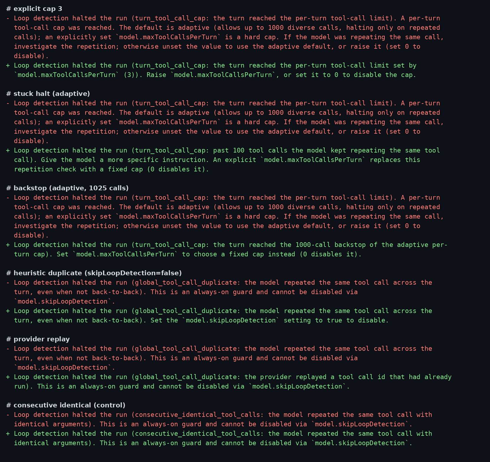

### 3. Daemon `turn_error` and telemetry

The raw SSE `turn_error.data`: `loopType` is the same on both arms, and only head adds the new fields.

| Cause | head adds |
| --- | --- |
| explicit cap 3 | `loopReason: explicit_cap`, `toolCallCount: 4`, `toolCallLimit: 3` |
| stuck halt | `stuck_repetition`, `110`, `100` (the batch is counted before it runs, as the telemetry doc says) |
| backstop | `backstop`, `1025`, `1000` |
| heuristic duplicate / provider replay | `repeated_call` / `provider_duplicate_id` |
| invalid params / repeated failure | nothing new; these types carry no reason, as designed |

The daemon's OTEL `loop_detected` matches: `explicit_cap` 4/3 and `provider_duplicate_id`.

### 4. Web Shell (real daemon, headless Chromium)

On base, all seven daemon causes show the same generic sentence. On head, each cause shows its own text, whether typed live, after a page reload, or in zh-CN. The repeated-failure case used `QWEN_CODE_ACP_REPEATED_TOOL_FAILURE_GUARD=enforce`, since the guard runs in shadow mode by default.

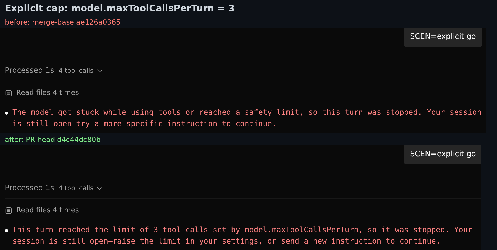
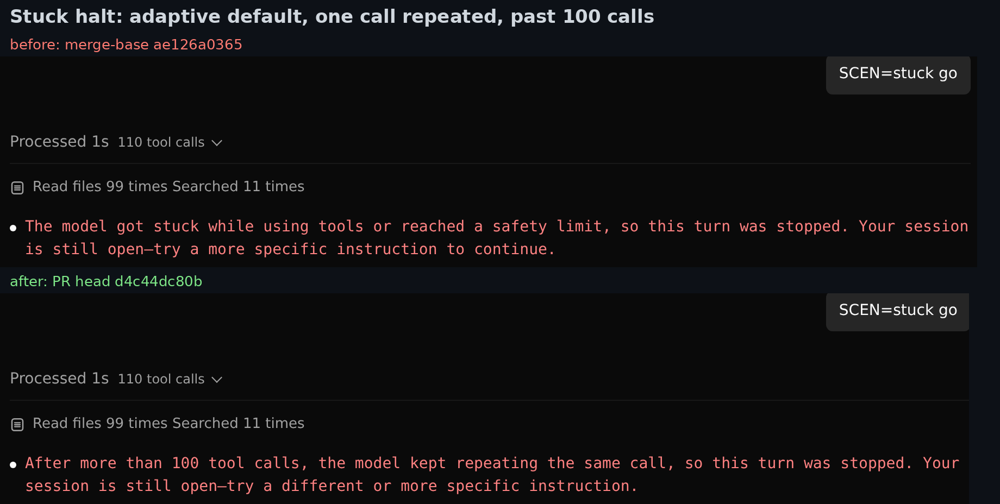
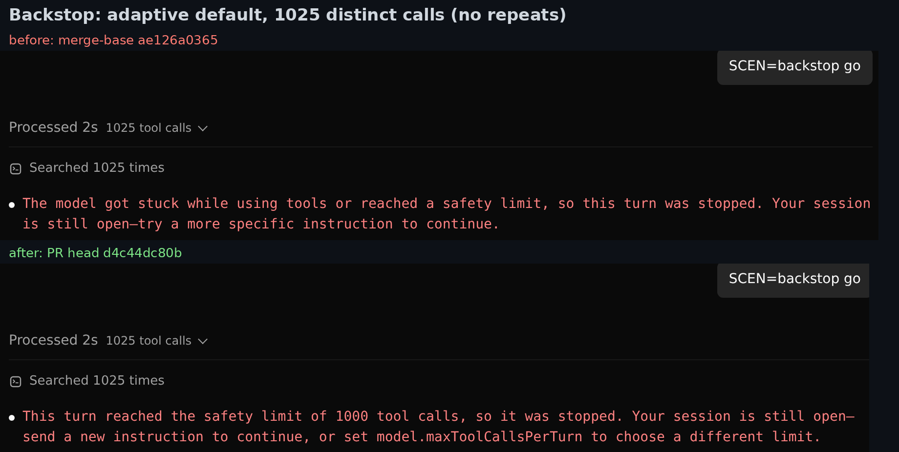

Other causes, reload and zh-CN screenshots

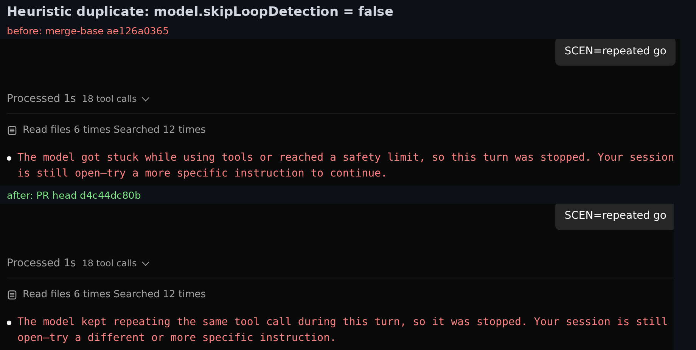
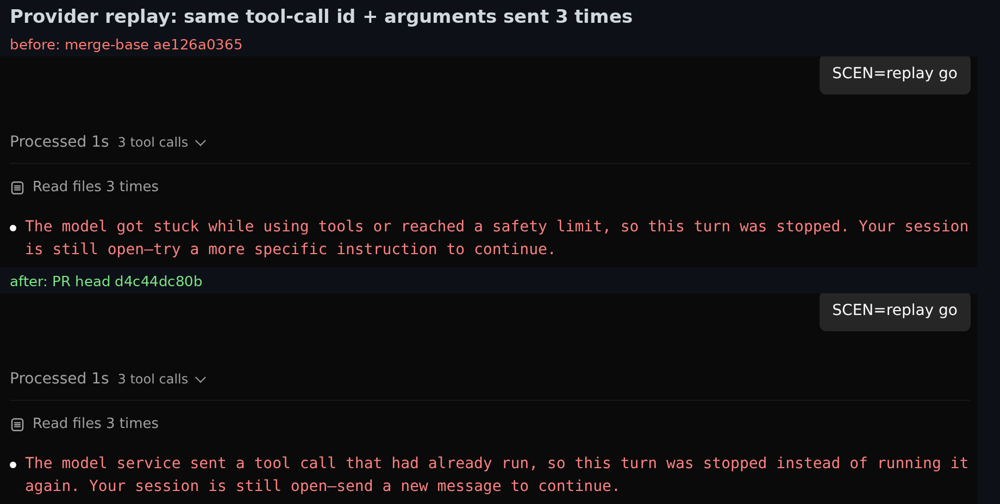
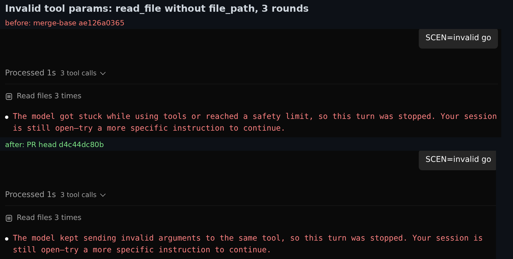
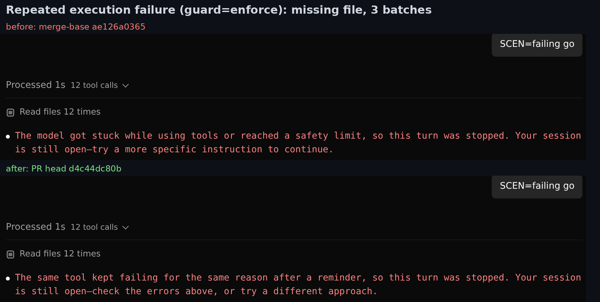
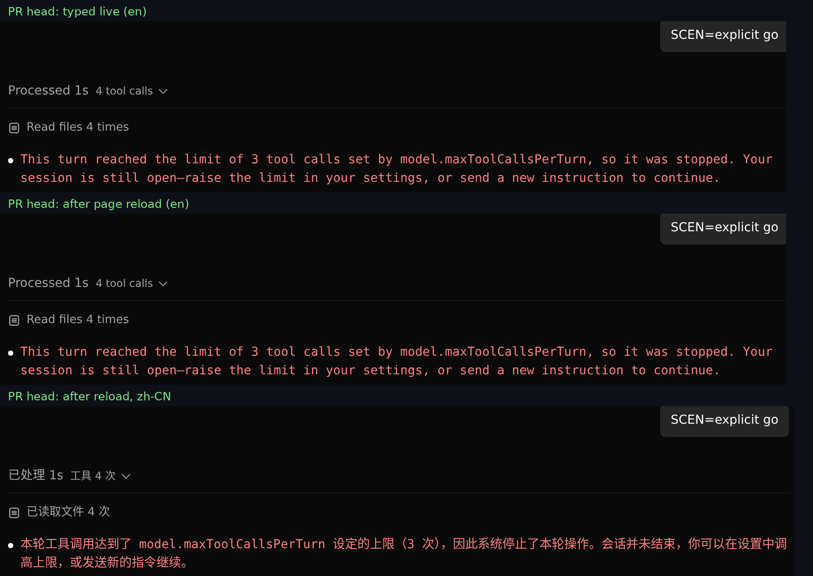
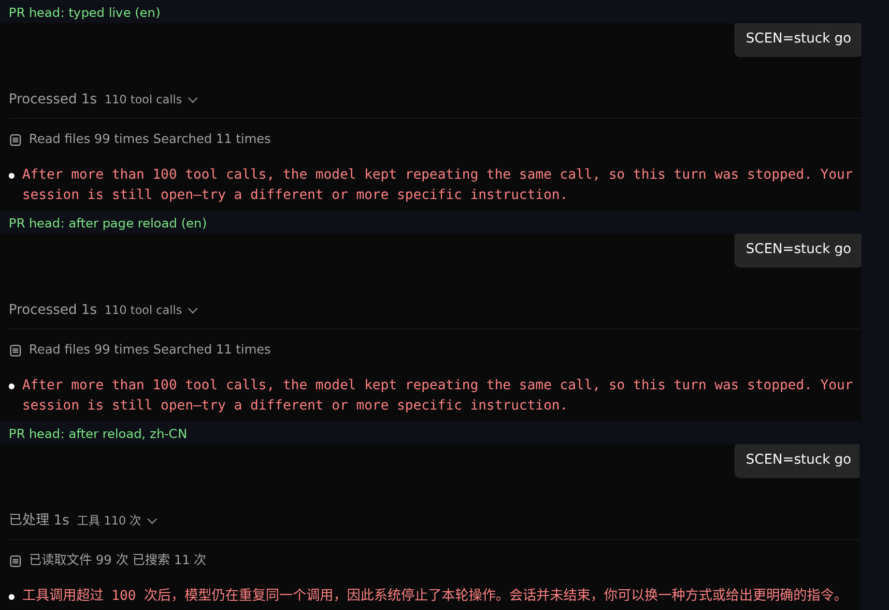

**Cross-version clients work in both directions.** I swapped the served `dist/web-shell` and confirmed the swap by the `index-<hash>.js` the daemon served. The head client on a base daemon shows the generic sentence, and so does the base client on a head daemon. Neither shows an error.

### 5. TUI and OpenTUI

On head, the loop dialog shows `Cause: …` for all four causes I tried, and the message after Esc matches the headless text. Base shows only the generic sentence. OpenTUI prints the per-cause message too (explicit cap tested).

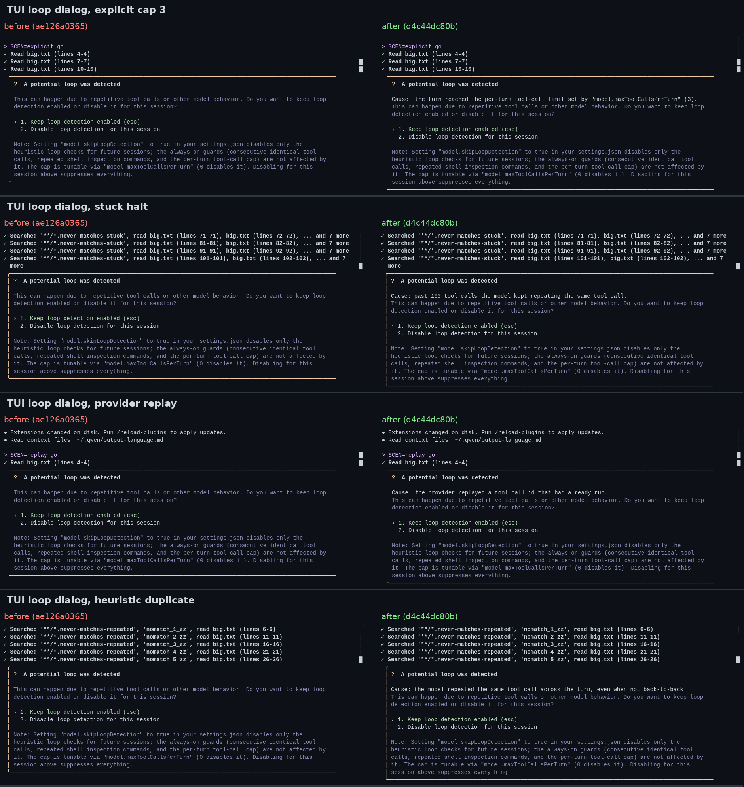

Message after Esc, and OpenTUI

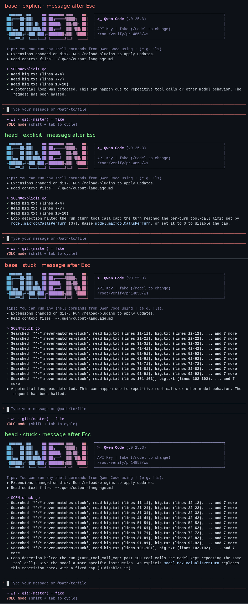
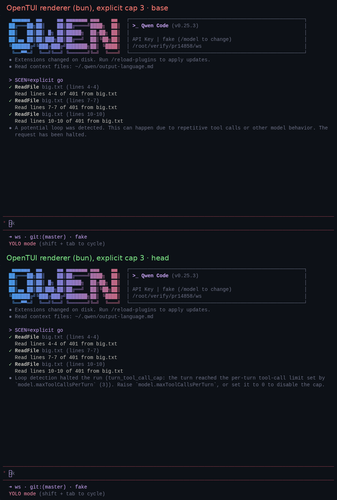

### 6. Tests

- **Unit tests on head, the PR's affected files:**

  | Package | Files | Tests |
  | --- | --- | --- |
  | core | 2 (`loopDetectionService`, all of `client.test.ts`) | 681 passed (166 + 515) |
  | cli | 6 | 1,831 passed, 1 skipped |
  | acp-bridge | 1 | 1,021 passed |
  | SDK | 1 | 429 passed |
  | Web Shell | 2 | 286 passed |

- **CI at this head:** Test, Lint & Static, Integration (no-AK), web-shell E2E smoke, TUI parity and the OpenTUI no-flicker gate are green.
- **Export renderer:** 2,041,619 bytes on base and 2,046,758 on head, +5,139, the same as the PR states. The old 2,045,000 cap would fail; the new cap leaves 3,242 bytes.
- **Mutation:** I applied 25 targeted mutants to the 14 changed production files that carry logic, and ran each against the PR's own tests for that file. **23 were caught; 2 survived.** The two survivors are in note 1 below.

### Notes (none blocking)

1. **Two small test gaps.** Two of the 25 mutants survive. The real runs above show the current code is correct in both places.
   - `packages/core/src/telemetry/qwen-logger/qwen-logger.ts`: deleting the RUM `loop_reason` spread still passes `qwen-logger.test.ts` and `loggers.test.ts`.
   - `packages/cli/src/acp-integration/session/Session.ts`: setting the daemon's `toolCallLimit` to `config.getMaxToolCallsPerTurn()` (100) instead of `capHalt.limit` still passes `Session.test.ts`. A backstop stop would then show "the safety limit of 100 tool calls" in Web Shell. The same mutant in core is caught; the daemon has no backstop test.

   One assertion each would pin them.
2. **OpenTUI shows raw backticks.** The shared text marks setting names with backticks. Ink renders them as inline code, and the dialog rewrites them to quotes, but OpenTUI prints them as-is: ``Raise `model.maxToolCallsPerTurn`, or set it to 0…`` (see the OpenTUI image). `event-adapter.ts` could reuse the dialog's rewrite.
3. **Renderer budget, for information.** 3,242 bytes are left under the new cap, so the next i18n addition will probably need another raise.
4. **Existing behavior on main, not caused by this PR.** After a daemon restart, a turn that loop protection stopped shows no stop message on either arm. The transcript shows only "The previous request was interrupted before the response completed. [Continue execution]" (image below). That banner also appears in a live session as soon as the turn stops, and again after a reload, on both arms. Control runs on both arms, a plain turn and a 20-round tool-call turn that ends normally, show no banner, so the banner comes from the loop stop. The UI offers to continue a turn that was stopped on purpose. The design doc limits its "survives a page refresh" claim to live sessions, and that holds. This might be worth a follow-up.

I also confirmed one limitation the PR already states: the TUI dialog still offers "Disable loop detection for this session" for a provider replay.

Cold load after a daemon restart (same on base and head)

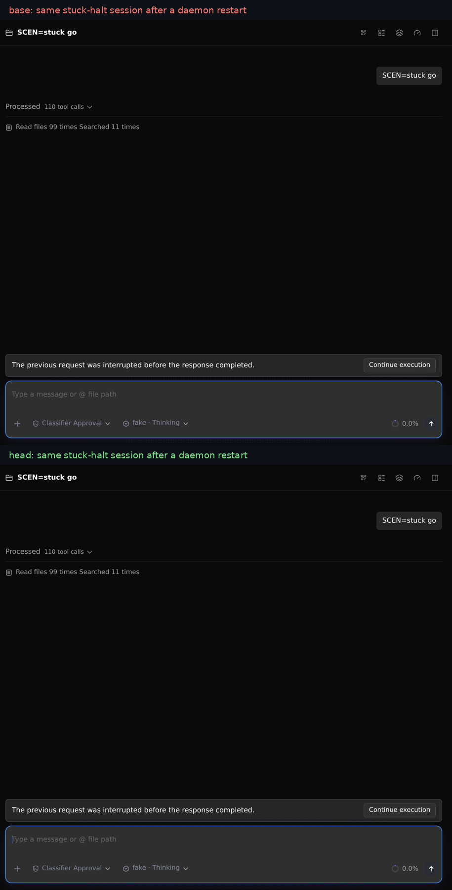

