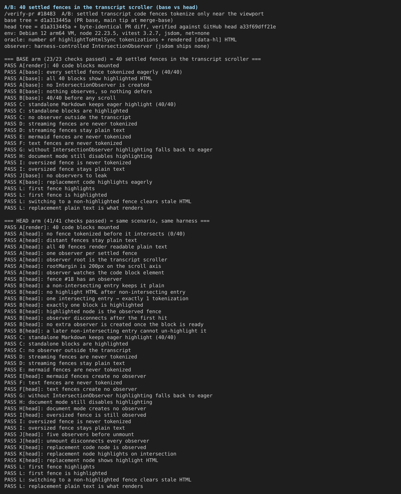
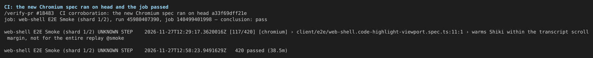
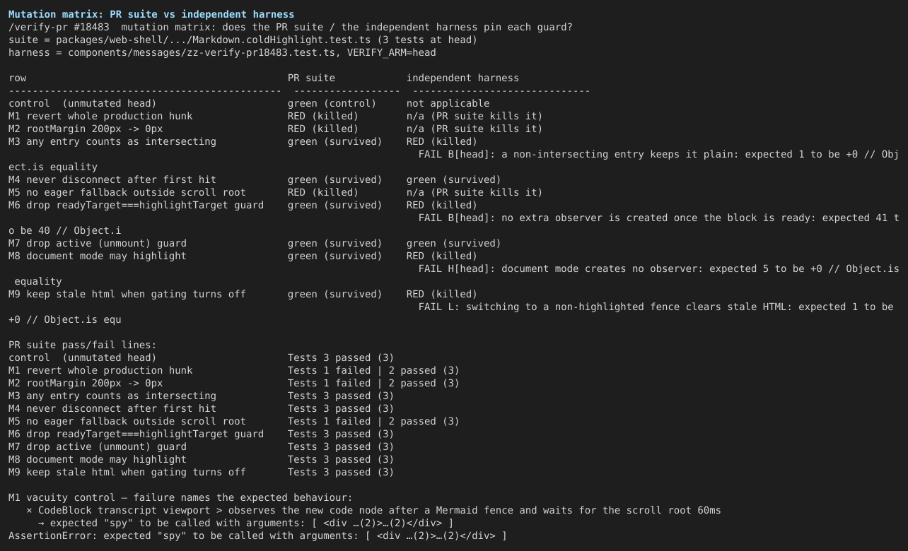

**merge-ready** — 96/96 scripted assertions passed, 0 failed · verified head `a33f69dff21e3ce9fa95c48b4b12250039fb028a` · base `d1a313445aee7848e45a8d819a2b81752ff9f686`

中文摘要

**结论：merge-ready（可合并）。** 96 项脚本化断言全部通过；没有阻塞问题，只有 4 条测试覆盖建议。

- **A/B 结论**：同一份含 40 个已结束代码块的会话，挂在真实滚动容器里。基线（base）挂载后立刻高亮 40/40 个代码块；head 在没有任何交集事件时是 0/40，只有 1 个进入观察范围的代码块被高亮（1/40），其余保持纯文本。独立 Markdown（没有滚动容器）两臂都是 40/40；流式、Mermaid、text、document 模式、超大代码块两臂都不高亮。观察器的 root 就是滚动容器，`rootMargin` 为 `200px 0px`。
- **测试有效性**：把 head 的生产代码整体回退到 base 后，PR 新增的测试按预期变红，报错正是"观察器未被调用"——该测试不是空转。
- **变异矩阵**：9 个单点变异里 PR 自带测试杀掉 3 个（回退整段、rootMargin 改 0、去掉无 root 时的立即高亮），存活 6 个；用独立 harness 复核，其中 4 个（M3 忽略 `isIntersecting`、M6 去掉 ready 守卫、M8 document 模式、M9 保留过期高亮）会被 harness 抓住，M4/M7 属冗余防御。这些是覆盖缺口，不是代码缺陷。
- **未覆盖**：本机隔离 VM 没有浏览器，PR 自带的 Chromium E2E 只在 CI 侧跑过（CI 通过，420/420，含该 spec）；全仓 typecheck 因依赖未构建在两臂报同样的 1248 个错误（A/A 对照完全一致），属环境限制；PR base 落后 main 57 个提交，但 main 没改 PR 的两个文件，GitHub 报 `mergeable=true`。

## Central claim and A/B

The PR's central claim: a settled code fence inside the transcript scroller is **not** tokenized/highlighted until it approaches the viewport (200 px scroll margin), while standalone Markdown keeps eager highlighting and streaming/Mermaid/plain-text fences stay plain.

The A/B below runs one harness file against two trees that differ only by the PR diff. The oracle is the number of `highlightToHtmlSync` calls plus the rendered `[data-hl]` markup, driven by a controllable `IntersectionObserver` (jsdom has none) whose `root`/`rootMargin` come from the production code.

| cell (identical harness, `VERIFY_ARM` only changes expectations) | base | head |
| --- | --- | --- |
| 40 settled `ts` fences inside `[data-web-shell-message-list]`, no intersection entry | **40/40 tokenized**, 40 highlighted | **0/40 tokenized**, 40 plain |
| same, one fence receives `isIntersecting: true` | 40/40 | **1/40** (exactly one tokenization) |
| same, fence not in a scroll root (standalone Markdown) | 40/40 | 40/40 |
| streaming fences (10) | 0 | 0 |
| Mermaid fences (3) | 0 | 0 |
| `text` fences (3) | 0 | 0 |
| `document` render mode (5) | 0 | 0 |
| oversized fence (`isTooLargeToHighlight`) | 0 | 0 |
| environment without `IntersectionObserver` (5) | 5/5 | 5/5 (eager fallback) |

Head-only shape checks: observer root === the scroller element, `rootMargin === '200px 0px'`, one observer per settled fence (40), a `isIntersecting: false` entry leaves the fence plain, the first intersecting entry disconnects the observer and highlights exactly once, a later entry cannot un-highlight it, unmount disconnects all 5 observers, and a Mermaid fence replaced by a `ts` fence is observed as the new node. Base arm: 23/23 checks; head arm: 41/41 checks, 0 failures.

The neighbouring suites agree: `Markdown.coldHighlight.test.ts Markdown.test.ts Markdown.mermaid.test.ts` — base `149 passed`, head `150 passed` (the extra test is the new `CodeBlock transcript viewport` case), 0 failures on either arm.

## Findings

No blocking finding: the production behaviour matches the claim in every cell above. The items below are test-coverage suggestions from the mutation matrix; each was measured, not inferred.

1. **Suggestion — the negative intersection branch is not pinned by the new test.** Replacing `entries.some((entry) => entry.isIntersecting)` with `entries.length > 0` leaves the PR suite at `3 passed (3)`. The independent harness catches it (`FAIL B[head]: a non-intersecting entry keeps it plain: expected 1 to be +0`). One fixture firing `[{ isIntersecting: false }]` before the positive entry would pin it.
2. **Suggestion — `document` mode exclusion is unpinned.** Dropping `!documentMode` from `canHighlight` also leaves the suite green; the harness then sees 5 observers created for 5 document-mode fences (`expected 5 to be +0`). A `TranscriptRenderModeProvider value="document"` fixture asserting zero observers and zero tokenizations would pin it.
3. **Suggestion — clearing stale highlight HTML when gating turns off is unpinned, and its failure is user-visible.** Removing `setHtml(null)` from the combined guard leaves the suite green, but a reused `CodeBlock` switching from a settled `ts` fence to a `text` fence then renders the previous block's highlighted code: `expected 'textcode.copyconst aaa = 1;' to contain 'plain replacement'`. This is the same staleness class the existing cold-path test was written for; extending it to the new gating branch would cover it.
4. **Suggestion — the ready-target guard has no assertion.** Dropping `readyTarget === highlightTarget` leaves the suite green and produces 41 observers for 40 fences (one extra observer per already-ready block). Asserting the observer count after a hit pins it.
5. **Nit — two redundant defences; no action needed.** The explicit `observer.disconnect()` after a hit (M4) is also performed by the effect cleanup when `readyTarget` changes, and the `active` guard (M7) only suppresses a state update after unmount, which React already ignores. Both survive the PR suite and the harness; they are harmless documentation of intent.

## Corrections

None. The body says the row-containment and polling-cadence changes were removed; the final diff indeed contains only the highlight gating plus its tests, so the description matches the code as reviewed.

## Not covered

- **Local Chromium measurement of the reported 2/2/2.** The isolated VM has no browser, so the PR's own `web-shell.code-highlight-viewport.spec.ts` was not executed locally. CI did execute it: `[117/420] [chromium] › client/e2e/web-shell.code-highlight-viewport.spec.ts:11:1 › warms Shiki within the transcript scroll margin, not for the entire replay @smoke` in run 45980407390 / job 140499401998, and the shard finished `420 passed (38.5m)`. That is CI's witness, not mine — the jsdom A/B proves the gating logic and the observer configuration, not browser layout geometry.

  

- **Full web-shell unit suite.** Only the three Markdown suites above were run; `MessageList.dom.test.tsx` and the rest of the package were not.
- **Typecheck.** `tsc -p tsconfig.json --noEmit` exits 2 on **both** arms with 1248 errors because the workspace packages were installed with `--ignore-scripts` and `@qwen-code/sdk`'s `dist` is absent (`Cannot find module '@qwen-code/sdk/daemon'`). `diff base-typecheck.log head-typecheck.log` is empty (A/A control), so this is environmental and not attributed to the PR.
- **Merged-tree re-measure.** Base is 57 commits behind `main` (300 files), though the commits API shows `main` did not touch the PR's two files since the base; GitHub reports `mergeable: MERGEABLE`. Neighbouring `packages/web-shell/client` files did change in that window (17 commits), so merged-tree behaviour of those imports was not re-measured.
- **`e2e` spec syntax/behaviour locally.** Playwright and a browser are not installed in the VM; the spec's selector assumptions (`[data-selection-code-language="typescript"]`, `[data-web-shell-message-list]`, `.shiki`) were exercised only through the jsdom harness, where all 40 blocks matched.

## Methodology

One paragraph: the work ran inside an ephemeral Debian 12 arm64 QEMU/KVM guest (`verify-vm` run `vm-20261128-170537-1921908`, 6 vCPU / 6 GiB, `--net none`, Node v22.23.5, vitest 3.2.7, no host filesystem share). The base tree is a full checkout of `d1a313445a`; the head tree is that same checkout with `gh pr diff 18483` applied, and all three changed files were `cmp`-verified byte-identical to the GitHub blobs at `a33f69dff21e` before anything ran. Dependencies came from the host pnpm store via `--frozen-lockfile --ignore-scripts`; head's `node_modules` was hardlinked from base in-guest, and `readlink -f node_modules/@qwen-code/web-shell` was asserted to resolve inside each respective tree (`/workspace/head/...` vs `/workspace/base/...`) so the control cannot silently load head code. The A/B harness (`harness/zz-verify-pr18483.test.ts`) mounts the real `Markdown` component from each tree inside a real `div[data-web-shell-message-list]`, stubs `codeHighlighter` (grammar loading needs workers jsdom lacks) and substitutes a controllable `IntersectionObserver`; it asserts tokenization counts and rendered `[data-hl]` markup, and runs the standalone/streaming/Mermaid/text/document/oversized controls on **both** arms. The mutation matrix edits the head production file in place (restored and checksum-verified after every row) and runs the PR's own `Markdown.coldHighlight.test.ts`; PR-suite survivors were re-run through the independent harness. Raw logs and JSON matrices are under `raw/`, the harness under `harness/`, and the capture sources under `evidence/*.txt`.

